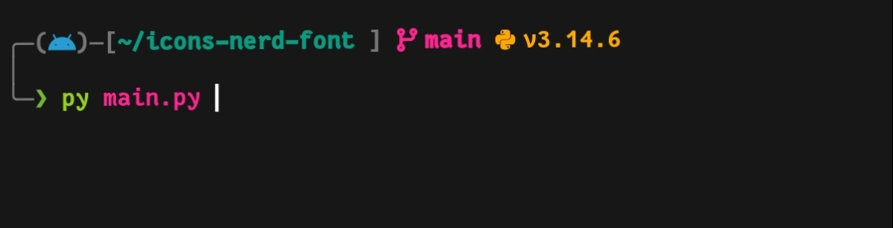
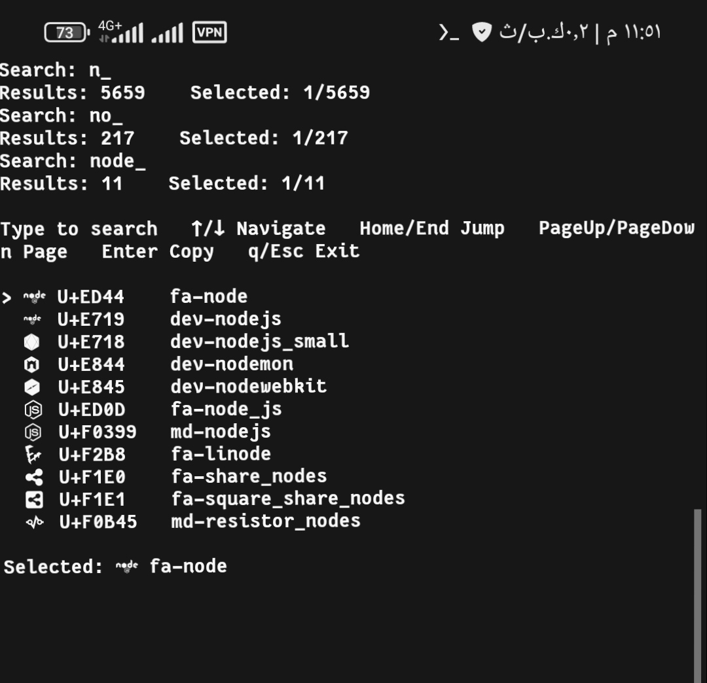
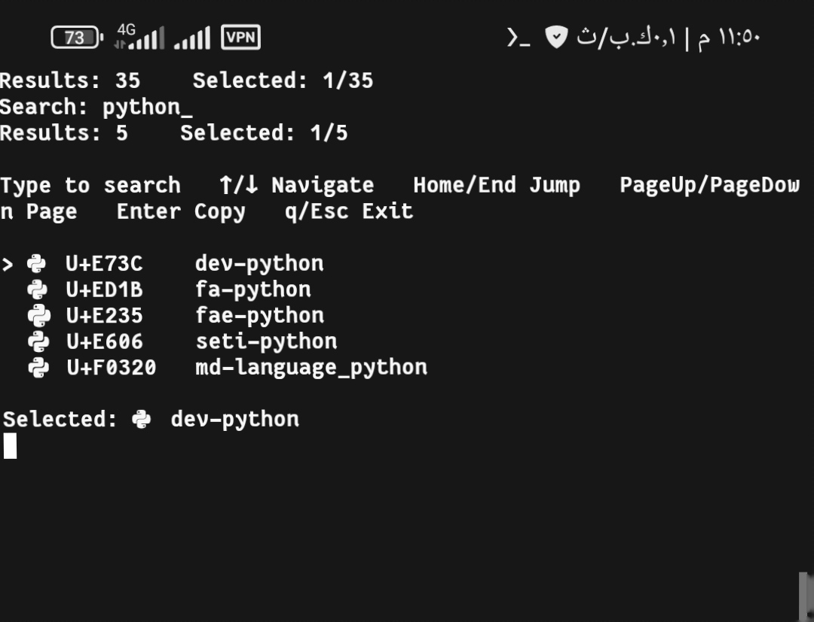
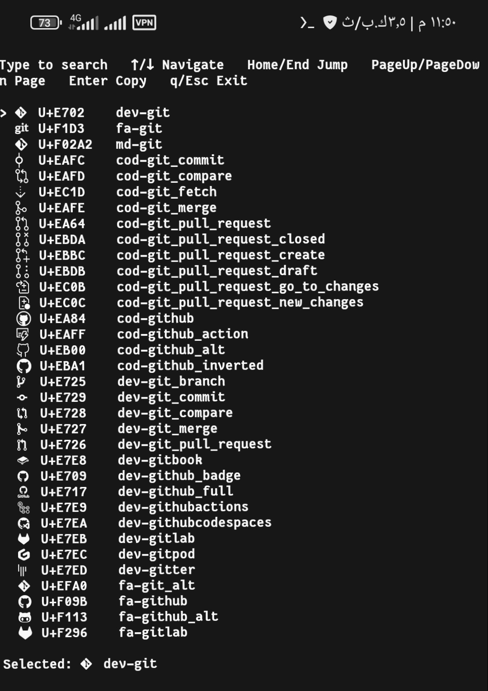
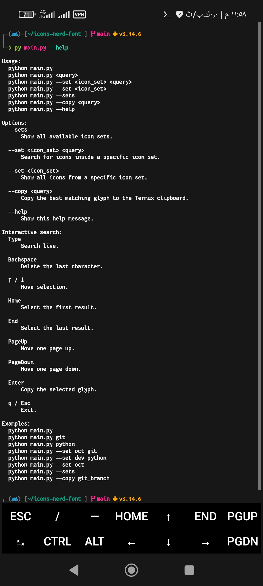

# icons-nerd-font

Search, browse and copy [Nerd Font](https://www.nerdfonts.com/) icons straight from your terminal.

It reads the icon glyphs baked into any patched Nerd Font file and lets you fuzzy-search them by name, either from the command line or in a live interactive picker. Pick an icon and it lands on your clipboard, ready to paste into your editor, status bar or shell config.


---


## Features

- Interactive fuzzy picker with live filtering, keyboard navigation and paging
- Non-interactive search and one-shot `--copy` for scripts and quick lookups
- Browse icons by set (`--sets`, `--set`): oct, dev, fa, weather, and more
- Works anywhere Python runs: Termux, Linux, macOS (X11/Wayland clipboard tools supported)
- Bring your own font with `--font`, or let it auto-detect an installed Nerd Font

## Requirements

- Python 3.9+
- A patched [Nerd Font](https://www.nerdfonts.com/font-downloads) (the tool reads its glyph names; your terminal must use a Nerd Font for the icons to display)
- A clipboard tool, one of: `termux-clipboard-set` (Termux:API), `pbcopy` (macOS), `wl-copy` (Wayland), `xclip` or `xsel` (X11). Without one, the glyph is printed so you can copy it manually.

## Install

With [pipx](https://pipx.pypa.io/) (recommended):

```sh
pipx install git+https://github.com/aelalmy45/icons-nerd-font.git
```

Or with pip:

```sh
pip install git+https://github.com/aelalmy45/icons-nerd-font.git
```

From a local clone:

```sh
git clone https://github.com/aelalmy45/icons-nerd-font.git
cd icons-nerd-font
pipx install .
```

## Usage

```sh
icons-nerd-font                 # open the interactive picker
icons-nerd-font git             # open the picker pre-filtered by "git"
icons-nerd-font --sets          # list all icon sets with counts
icons-nerd-font --set oct       # list every icon in the "oct" set
icons-nerd-font --set oct git   # search "git" inside the "oct" set
icons-nerd-font --copy git_branch   # copy the best match, no picker
icons-nerd-font --help          # full help
```

### Choosing the font

The glyph source is resolved in this order:

1. `--font <path>` - use exactly this font file
2. `$NERD_FONT` environment variable
3. `~/.termux/font.ttf` (the Termux default)
4. The first installed font with "nerd" in its filename, found by scanning the usual font directories (`~/.local/share/fonts`, `/usr/share/fonts`, `~/Library/Fonts`, ...) and via `fc-list` when fontconfig is available

Only fonts that actually contain private-use icon glyphs are accepted, so a non-patched font is never picked by mistake.

```sh
icons-nerd-font --font ~/fonts/JetBrainsMonoNerdFont-Regular.ttf git
NERD_FONT=~/.local/share/fonts/FiraCodeNerdFont-Regular.ttf icons-nerd-font
```

### Interactive keys

| Key | Action |
| --- | --- |
| Type | Search live |
| Backspace | Delete last character |
| Up / Down | Move selection |
| Home / End | Jump to first / last result |
| PageUp / PageDown | Page through results |
| Enter | Copy the selected glyph |
| q / Esc | Exit |


---

---


## Development

```sh
git clone https://github.com/aelalmy45/icons-nerd-font.git
cd icons-nerd-font
pip install -e .
icons-nerd-font --help
```

The package also runs as `python -m icons_nerd_font`, and `python main.py` remains as a shim for older muscle memory.

## Project structure

```
icons_nerd_font/
  cli.py             argument parsing and command dispatch
  fonts.py           Nerd Font detection (--font, $NERD_FONT, Termux, fontconfig)
  glyph.py           font parsing (fontTools), Glyph model, search scoring
  ui.py              interactive picker
  keyboard.py        raw terminal key input
  terminal_utils.py  screen drawing helpers
  clipboard.py       cross-platform clipboard
  help_text.py       --help output
```
